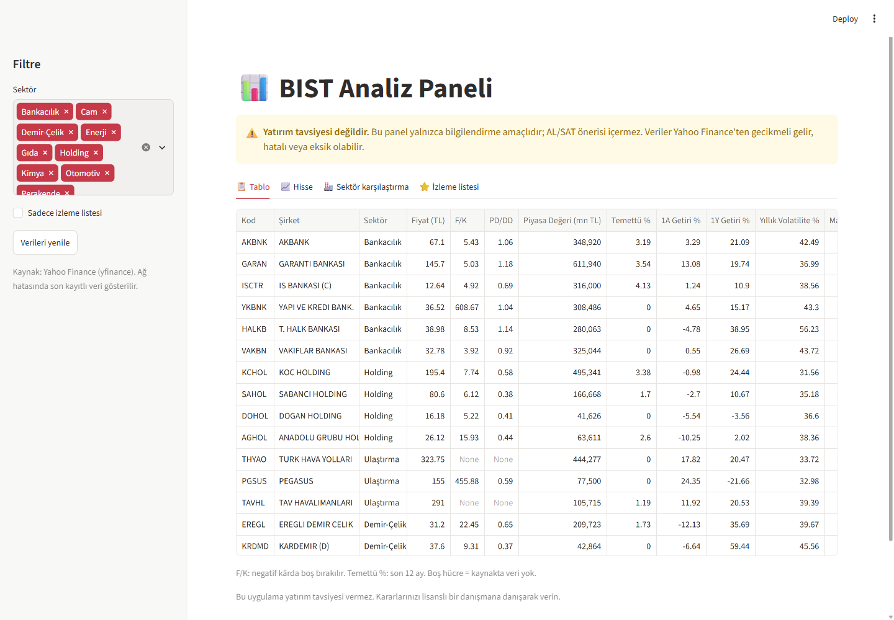
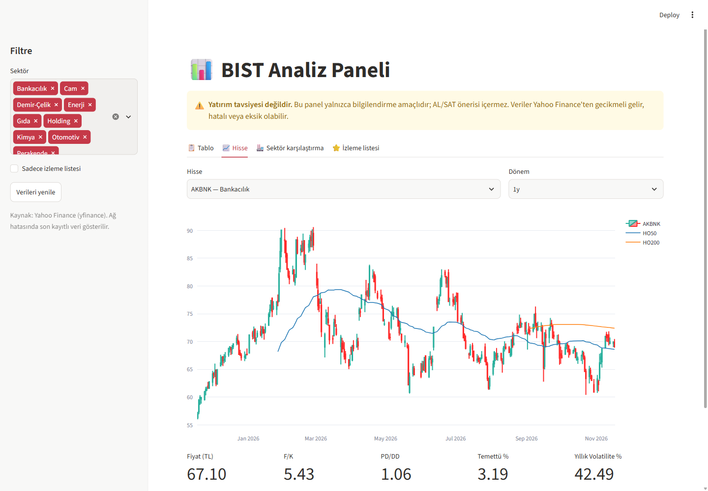
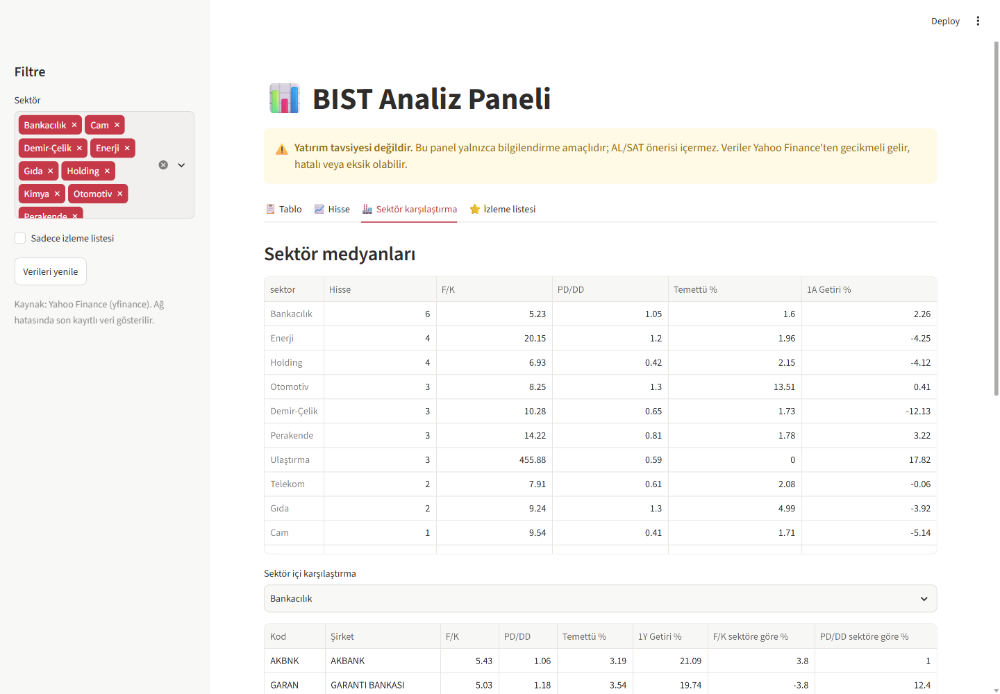

# 📊 BIST Analiz Paneli

Borsa İstanbul hisseleri için ücretsiz veriyle çalışan, Python + Streamlit ile yazılmış bilgilendirme paneli.
Fiyat ve temel oranları (F/K, PD/DD, piyasa değeri, temettü verimi) aynı tabloda gösterir; hisse grafiği,
sektör karşılaştırması ve izleme listesi içerir.

> ⚠️ **Yatırım tavsiyesi değildir.** Bu proje yalnızca eğitim/bilgilendirme amaçlıdır. AL/SAT önerisi,
> sinyal veya hedef fiyat üretmez. Veriler Yahoo Finance'ten gecikmeli gelir; hatalı veya eksik olabilir.
> Yatırım kararlarınızı lisanslı bir danışmana danışarak verin.



| Hisse grafiği | Sektör karşılaştırma |
|---|---|
|  |  |

## Özellikler

- **Tablo:** 34 BIST hissesi — fiyat, F/K, PD/DD, piyasa değeri, temettü %, 1 ay / 1 yıl getiri,
  yıllık volatilite, zirveden maksimum düşüş. Sektör filtresi, CSV indirme.
- **Hisse:** Mum grafiği + 50 ve 200 günlük hareketli ortalama (3 ay – 5 yıl).
- **Sektör karşılaştırma:** Sektör medyanları, sektör içinde her hissenin F/K ve PD/DD'sinin
  sektör medyanına göre farkı, 1 yıllık normalize (başlangıç = 100) performans grafiği.
- **İzleme listesi:** Seçtiğiniz hisseler yerel `izleme_listesi.json` dosyasına kaydedilir.

## Veri kalitesi kuralları

Yahoo verisi olduğu gibi gösterilmez; bilinen sorunlar düzeltilir:

| Durum | Davranış |
|---|---|
| Negatif kâr | F/K boş bırakılır (anlamsız) |
| F/K veya PD/DD yok | Fiyat / EPS ve fiyat / defter değerinden hesaplanır |
| Şirket bilançoyu USD/EUR raporluyor (ör. THYAO, TAVHL, ENKAI) | Yahoo'nun F/K ve PD/DD'si TL fiyatı döviz bilançoya böldüğü için **gösterilmez**, "Not" kolonunda belirtilir |
| `dividendYield` birimi | yfinance ≥ 0.2.54'te yüzde olarak gelir (0.13 = %0,13); buna göre işlenir |
| Boş (NaN) fiyat günleri | Hesaplamalardan çıkarılır |

## Cache ve ağ hatası

- Temel oranlar 6 saat, fiyat geçmişi 30 dakika diskte (`.cache/`, JSON) saklanır; ayrıca Streamlit cache'i kullanılır.
- Ağ hatası olursa **son kayıtlı (eski) veri** gösterilir ve ekranda belirtilir. Hiç kayıt yoksa ilgili hisse
  boş görünür; uygulama çalışmaya devam eder.
- Sol menüdeki **Verileri yenile** butonu Streamlit cache'ini temizler.

## Kurulum

```bash
git clone https://github.com/preptyH/bist-analiz-paneli
cd bist-analiz-paneli
python -m venv .venv
# Windows: .venv\Scripts\activate    macOS/Linux: source .venv/bin/activate
pip install -r requirements.txt
streamlit run app.py
```

İlk açılışta 34 hissenin verisi paralel çekilir (~15-30 sn); sonraki açılışlar cache'ten gelir.
API anahtarı gerekmez.

Hisse listesini değiştirmek için `bist/semboller.py` içindeki `HISSELER` sözlüğünü düzenleyin.

## Testler

```bash
pytest -q
```

31 test, ağa çıkmadan çekirdek hesapları doğrular: oran hesapları ve birim düzeltmeleri, döviz uyumsuzluğu,
getiri, volatilite, maksimum düşüş, hareketli ortalama, normalize seri, sektör medyanı ve farkları,
cache okuma/yazma, ağ hatasında eski cache'e düşme, bozuk cache dosyası, izleme listesi.

## Proje yapısı

```
app.py              Streamlit arayüzü
bist/hesap.py       Saf hesap fonksiyonları (test edilen çekirdek)
bist/veri.py        yfinance erişimi + disk cache + hata toleransı
bist/semboller.py   Hisse listesi ve sektörler
bist/izleme.py      İzleme listesi (yerel JSON)
tests/              pytest testleri
```

## Lisans

MIT. Veriler Yahoo Finance'e aittir; kullanım koşulları için Yahoo'nun şartlarına bakın.
Bu proje Borsa İstanbul veya Yahoo ile bağlantılı değildir.
